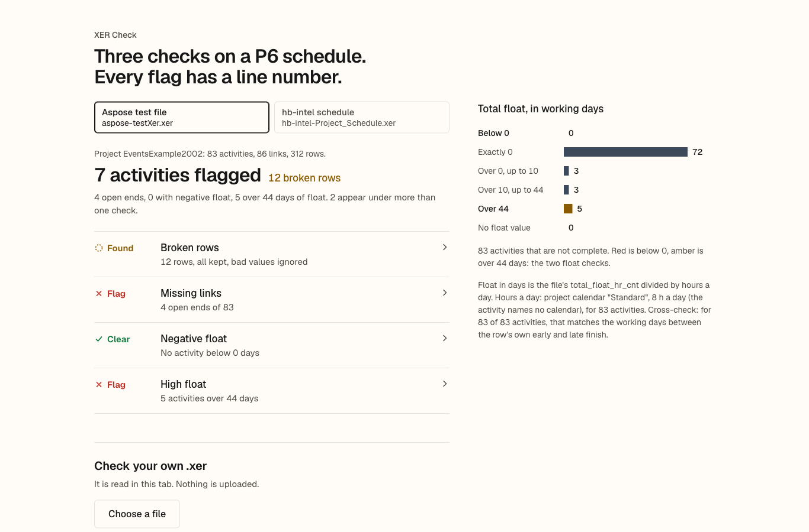

# XER Check

Reads Primavera P6 schedule files (.xer), flags broken rows with their line numbers, and runs three checks: missing links, negative float and high float. One chart shows total float per file. It runs in the browser as a static page, and as a small Node command.

Live: https://ikpemosiarnold.github.io/xer-check/

Built on 12 Nov 2026 with AI coding agents, directed by Arnold Ikpemosi Adeyemi.



## Run it

No dependencies to install. Node 18 or later.

```sh
node serve.js            # then open http://127.0.0.1:8772/
node check.js samples/aspose-testXer.xer samples/hb-intel-Project_Schedule.xer
node check.js my.xer --high 30 --json
node --test              # 9 tests
```

The page loads the two sample files below and has a button to check your own .xer. Your file is read in the browser tab and is not uploaded. The page is plain HTML, CSS and ES modules, so GitHub Pages can serve the folder as it is. Opening `index.html` straight from disk will not load the samples, because browsers block module scripts and fetch on `file://`. Serve the folder instead: `node serve.js` or `python3 -m http.server`.

## The two files

Both are public files in public GitHub repositories under the MIT licence, which allows copying and redistribution with the licence notice. The notices are next to the files in `samples/`. Neither publisher says which tool wrote the file, so the notes below say what the file itself shows.

| File in this repo | Source | Licence | What is in it |
| --- | --- | --- | --- |
| `samples/aspose-testXer.xer` | [aspose-tasks-cloud/Aspose.Tasks-Cloud-SDK-for-Python, testData/testXer.xer](https://github.com/aspose-tasks-cloud/Aspose.Tasks-Cloud-SDK-for-Python/blob/2a4342e271917b276e9cd6dee2b51c0ed9571182/testData/testXer.xer) | MIT, Copyright (c) 2020 aspose-tasks-cloud, `samples/aspose-testXer.LICENSE.txt` | Project EventsExample2002: 83 activities, 86 links. Header says P6 8.3. Calendar dates in US format, a blank user name in the header line, and TASK rows with no proj_id or clndr_id suggest it was written by a converter, not P6 itself. |
| `samples/hb-intel-Project_Schedule.xer` | [RMF112018/hb-intel, docs/reference/example/Project_Schedule.xer](https://github.com/RMF112018/hb-intel/blob/ff2710c1bc1d01ccfe2ecd114a08e595ae193a10/docs/reference/example/Project_Schedule.xer) | MIT, Copyright (c) 2026 RMF, `samples/hb-intel-Project_Schedule.LICENSE.txt` | Project STA, a building envelope repair across ten buildings: 281 activities, 261 links. Header says P6 7.0, but it reads as written by a script, not P6: all 281 activities are TT_Task and not started, zero-length activities finish the day before they start, and 11 names carry a literal "?" where a dash was probably lost (it is in the source bytes). The CALENDAR table has no day_hr_cnt column. |

Both files are byte-for-byte copies of the source at the commit in the link.

## What it found

| | aspose-testXer.xer | hb-intel-Project_Schedule.xer |
| --- | --- | --- |
| Broken rows | 12, all kept: CALENDAR lines 14 to 25 have last_chng_date "2/12/2004 3:19:00 PM", not XER date form | 0 |
| Missing links | 4 of 83: A1000 has no links at all, A1010 has no predecessor, A1150 and A1820 have no successor | 32 of 281. Building B01 follows the award through the M and MOB activities. Buildings B02 to B10 are tied to nothing: Mobilization has no predecessor (9) and Temporary Relocation has no links at all (9). Demobilization has no successor in all 10 buildings. The other 4 are P-001 (the first activity), C-001, C-002 and VAC-B01. |
| Negative float | 0 | 0 |
| High float (over 44 days) | 5, from 108 to 125 days | 11: two closeout activities at 116 days and 9 relocations at 78 days. All 11 are also open ends. |
| Hours a day used | 8, from the project calendar "Standard" (every TASK row has a blank clndr_id) | 8, the fallback (no day_hr_cnt in the file) |
| Units cross-check | 83 of 83 agree | 281 of 281 agree |

Two notes. In the Aspose file, A1820 "Start up the business" is the last activity but is typed as a start milestone (TT_Mile), so the rule flags its missing successor. In the hb-intel file, 234 of 281 activities have exactly 43 days of float, one day under the high float line. They are buildings B02 to B10, 26 activities each. With no predecessor on Mobilization, all nine start on 2 Mar 2026, the first day of the project and a week before Contract Negotiation & Award starts. The high float check passes them; the missing links check explains them. `node check.js samples/hb-intel-Project_Schedule.xer --high 42` moves the count from 11 to 245.

## How it reads a file

The parser splits the file on tabs: `%T` starts a table, `%F` names its fields, `%R` is a row. Every `%R` row is either used or listed as broken with its line number. Nothing is dropped quietly.

A row is broken when:

- its field count does not match the table's `%F` line (set aside);
- its task_id, task_pred_id or clndr_id repeats an earlier one (set aside, the first is kept);
- a link points to a task_id that is not in the TASK table (set aside);
- a link type is not PR_FS, PR_SS, PR_FF or PR_SF (set aside);
- a link joins an activity to itself, or repeats an earlier link (set aside);
- a date field (`*_date`) or number field (`*_hr_cnt`, `*_qty`, `*_pct`) in PROJECT, CALENDAR, TASK or TASKPRED does not parse (kept, the value is ignored);
- an activity has an unknown task_type or status_code, or names a calendar that is not in the file (kept).

## The three checks

Only activities that are not complete are judged. Level of effort (TT_LOE) and WBS summary (TT_WBS) activities are skipped, because they do not carry logic of their own.

- **Missing links.** An activity needs at least one predecessor and one successor. A start milestone (TT_Mile) may have no predecessor, and a finish milestone (TT_FinMile) may have no successor. Nothing else is excused. Links that were set aside as broken do not count.
- **Negative float.** Total float below 0.
- **High float.** Total float above 44 working days. 44 days is the line the DCMA 14-point schedule assessment uses: about two months of slack, which usually means a missing link.

Float comes from the file's own `total_float_hr_cnt`. It is in hours, so it is divided by the hours in a working day: the activity's calendar `day_hr_cnt`, else the project calendar's, else the default calendar's, else 8. The page and the command say which one was used. The comparison with 44 days is made in hours (44 times that calendar's hours a day) so rounding cannot move an activity across the line.

**Units cross-check.** If the hours a day are right, float in days should equal the working days between the row's own early finish and late finish. The checker counts those days on a Monday to Friday calendar and reports how many agree. It ignores holidays, so it is a check on the unit, not a recompute of the schedule.

## The chart

Total float in working days, one bar per band, for the selected file. The bands line up with the checks: below 0 is red (negative float), over 44 is amber (high float). It shows at a glance how much of a schedule is critical and how much is loose.

## What AI got wrong

To make sure float in hours really meant 8-hour days, the agent wrote a cross-check: count the working days between each row's early finish and late finish, and compare with total_float_hr_cnt / 8. It compared dates only, and reported 40 rows that disagreed. That looked like a wrong unit or a file whose float could not be trusted.

Reading those 40 rows showed the script was wrong, not the files. Four are milestones in the Aspose file with a late finish at 08:00, which is the same working moment as 17:00 the working day before. The other 36 are zero-length activities in the hb-intel file. That file writes a zero-length finish at 17:00 on the day before the start, so a Monday start gives a Sunday finish, on a calendar named 5 Day. In working time that is the close of Friday. The fix counts a finish at 08:00 or on a weekend as the close of the working day before. After it, 83 of 83 and 281 of 281 rows agree, and that agreement is what confirms the 8-hour unit for both files. A separate sign points the same way: the 5 Day calendar's clndr_data lists 08:00 to 12:00 and 13:00 to 17:00, Monday to Friday.

The full log, with four more entries, is in [NOTES-ai-mistakes.md](NOTES-ai-mistakes.md).

## Limits

- It trusts the file's float. It does not recompute the schedule, so a file whose float was never calculated will show its stale numbers.
- The units cross-check assumes Monday to Friday and ignores holidays.
- One project per file. Multi-project files are read, but links to tasks in other projects show up as broken rows.
- Fonts: Geist and Newsreader (SIL Open Font License), latin subsets in `fonts/`, licences in `fonts/*-OFL.txt`.

## Licence

Code: MIT, see `LICENSE`. The sample files keep their own MIT notices in `samples/`.
